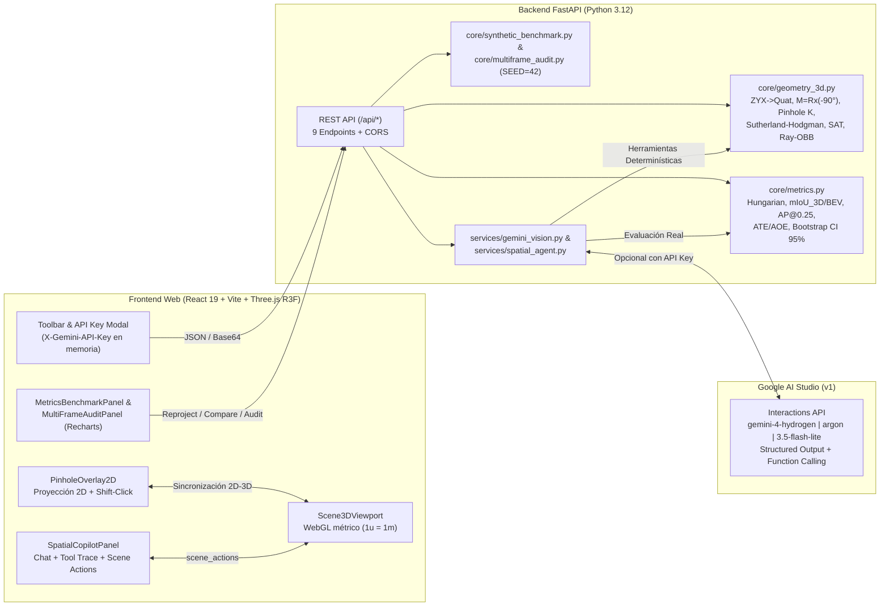

# MyLeenTo3 — Laboratorio de Percepción Espacial 3D Monocular y Auditoría Geométrica

> **Monocular 3D Spatial Understanding, Pinhole Reprojection & Multi-Frame Geometric Consistency Workbench**
>
> Proyecto afín elaborado para la postulación al **Summer Camp PUCP en Inteligencia Artificial 2027** (*Grupo de Investigación en Inteligencia Artificial — IA-PUCP*).
>
> **Autor:** Matias Darío Huerta Cruz · Estudiante de 8vo ciclo de Ingeniería Informática — Universidad Peruana Cayetano Heredia (UPCH) · Miembro del Laboratorio de Inteligencia Artificial (L.I.A. — UPCH) · [`github.com/dariohuerta84/MyLeenTo3`](https://github.com/dariohuerta84/MyLeenTo3)

---

## 1. Motivación y Resumen Técnico

Los modelos fundacionales visión-lenguaje (*Vision-Language Models*, VLMs) recientes permiten inferir **cajas delimitadoras orientadas 3D de 9 grados de libertad (9-DOF OBB)** a partir de una única fotografía RGB monocular. Sin embargo, su despliegue científico y práctico en visión por computador 3D enfrenta tres brechas estructurales:

1. **Calibración geométrica y sensibilidad al campo de visión ($\text{FOV}_h$):** sin una proyección *pinhole* analítica controlada y un cambio de base que preserve la quiralidad ($\det(M) = +1$), las poses predichas presentan distorsiones de escala, espejado de ejes o desalineación 2D↔3D.
2. **Alucinaciones aritméticas en agentes LLM:** delegar al modelo de lenguaje el cálculo de distancias euclidianas, *clearance* entre superficies, colisiones SAT u oclusiones produce errores numéricos no verificables.
3. **Diferencia entre *World Models* implícitos y percepción 3D explícita:** los modelos generativos interactivos de mundo (como *Google Genie* o *Veo*) sintetizan secuencias de video visualmente plausibles, pero carecen de API pública y no exponen poses métricas explícitas $[x, y, z, \Delta x, \Delta y, \Delta z, r, p, y]$, sufriendo deriva de escala (*scale drift*) y oscilación de orientación (*yaw jitter*) entre cuadros consecutivos.

**MyLeenTo3** aborda estas tres brechas mediante un laboratorio web reproducible de precisión óptica:
- Integra la **`Interactions API` estable (`v1`) de Google AI Studio** (`google-genai >= 3.6.1`) con los modelos permitidos `gemini-4-hydrogen` (por defecto, `thinking_level="high"`), `gemini-4-argon` (`medium`) y `gemini-3.5-flash-lite` (`low`), usando *Structured Output* y *Function Calling* multi-turno.
- Ejecuta **toda la geometría 3D, métricas y auditoría en Python determinístico** (`NumPy` / `SciPy`), garantizando reproducibilidad exacta (`SEED = 42`) y un modo *Calibrated Benchmark* completamente funcional sin conexión ni clave API.
- Sincroniza una vista 2D *pinhole* con un visor WebGL métrico en **React 19 + Three.js (`@react-three/fiber`)** con deslizador de despliegue *2D → 3D Unfold*, regla métrica 3D, trazado de rayos de oclusión y copiloto espacial con ejecución transparente de herramientas.

📄 **Documento académico formal (PUCP 2027):** [`docs/Proyecto_Afin_MyLeenTo3_PUCP2027.pdf`](docs/Proyecto_Afin_MyLeenTo3_PUCP2027.pdf) (fuente reproducible: [`docs/proyecto_afin_pucp_2027.md`](docs/proyecto_afin_pucp_2027.md) y [`docs/build_pucp_pdf.py`](docs/build_pucp_pdf.py)).

---

## 2. Arquitectura del Sistema



---

## 3. Formulación Matemática

### 3.1 Representación 9-DOF y Cuaternión Intrínseco ZYX
Cada objeto detectado en el sistema de coordenadas de cámara Gemini (**$X$ derecha, $Y$ profundidad hacia adelante, $Z$ arriba**) se parametriza mediante:

$$\mathbf{b} = [x, y, z, \Delta x, \Delta y, \Delta z, r, p, \psi] \in \mathbb{R}^9$$

donde $(x, y, z)$ es el centroide en metros, $(\Delta x, \Delta y, \Delta z)$ las dimensiones del cuboide en metros y $(r, p, \psi)$ los ángulos de Euler intrínsecos ZYX (*roll, pitch, yaw*) en grados. Convertidos a radianes, el cuaternión unitario $\mathbf{q} = (q_x, q_y, q_z, q_w)$ sigue la convención oficial de Gemini 3D:

$$\begin{aligned}
q_x &= s_r c_p c_\psi - c_r s_p s_\psi, & q_y &= c_r s_p c_\psi + s_r c_p s_\psi, \\
q_z &= c_r c_p s_\psi - s_r s_p c_\psi, & q_w &= c_r c_p c_\psi + s_r s_p s_\psi
\end{aligned}$$

### 3.2 Cambio de Base Preservando Quiralidad (Gemini $\rightarrow$ Three.js)
Three.js utiliza una base diestra con $X$ derecha, $Y$ arriba y $Z$ hacia el observador ($-Z$ profundidad). La matriz ortogonal de transformación $M = R_x(-90^\circ) \in SO(3)$ preserva la orientación espacial ($\det(M) = +1$, sin inversión de quiralidad):

$$M = \begin{pmatrix} 1 & 0 & 0 \\ 0 & 0 & 1 \\ 0 & -1 & 0 \end{pmatrix}, \qquad \mathbf{p}_{\text{three}} = M\mathbf{p}_{\text{gem}} = \begin{pmatrix} x \\ z \\ -y \end{pmatrix}, \qquad R_{\text{three}} = M R_{\text{gem}} M^\top, \qquad \mathbf{s}_{\text{three}} = (\Delta x, \Delta z, \Delta y)$$

### 3.3 Proyección Pinhole 3D $\rightarrow$ 2D y Sensibilidad al $\text{FOV}_h$
Para proyectar los 8 vértices de la OBB al plano imagen de resolución $W \times H$ con campo de visión horizontal $\text{FOV}_h$:

$$R_{\text{view}} = R_x(+90^\circ) = \begin{pmatrix} 1 & 0 & 0 \\ 0 & 0 & -1 \\ 0 & 1 & 0 \end{pmatrix}, \qquad f = \frac{W}{2\tan(\text{FOV}_h / 2)}, \qquad K = \begin{pmatrix} f & 0 & W/2 \\ 0 & f & H/2 \\ 0 & 0 & 1 \end{pmatrix}$$

$$\mathbf{p}_{\text{cv}} = R_{\text{view}}\,\mathbf{p}_{\text{gem}}, \qquad u = f \frac{x_{\text{cv}}}{\max(z_{\text{cv}}, 0.05)} + \frac{W}{2}, \qquad v = f \frac{y_{\text{cv}}}{\max(z_{\text{cv}}, 0.05)} + \frac{H}{2}$$

El campo de visión vertical exacto empleado en la cámara perspectiva de Three.js es:

$$\text{FOV}_v = 2 \arctan\!\left(\tan\!\left(\frac{\text{FOV}_h}{2}\right)\cdot\frac{H}{W}\right)$$

### 3.4 Métricas Geométricas, Colisiones y Oclusión
- **$\text{IoU}_{\text{BEV}}$:** intersección exacta de polígonos proyectados en el plano $XY$ mediante recorte de **Sutherland-Hodgman**.
- **$\text{IoU}_{\text{3D}}$:** volumen prismático analítico exacto cuando $|r|, |p| < 2^\circ$; para cajas inclinadas arbitrariamente, descarte temprano mediante **Teorema de Ejes Separadores (SAT, 15 ejes)** seguido de muestreo estratificado determinístico (`SEED = 42`).
- **Emparejamiento y Evaluación:** asignación óptima vía algoritmo Húngaro (`scipy.optimize.linear_sum_assignment`), reportando $\text{mIoU}_{\text{3D}}$, $\text{mIoU}_{\text{BEV}}$, $\text{AP}@0.25$, $\text{AP}@0.50$, error absoluto de traslación ($\text{ATE}$ en metros), escala ($\text{ASE}$), orientación ($\text{AOE}$ en grados) e intervalos de confianza *bootstrap* al 95% ($N_{\text{boot}} = 1000$).
- **Matriz de Oclusión por Rayos:** trazado determinístico desde el origen óptico $(0,0,0)$ hacia 9 puntos objetivo (8 vértices + centroide) de cada objeto posterior usando intersección de losas **Kay-Kajiya** en coordenadas locales de cada OBB oclusora.

---

## 4. Benchmarks Calibrados y Auditoría Multi-Frame

MyLeenTo3 incluye un conjunto determinístico (`SEED = 42`, resolución $960 \times 640$, $\text{FOV}_h = 60^\circ$) de 3 escenas sintéticas calibradas renderizadas con iluminación Lambertiana (*painter's algorithm*):

| Benchmark ID | Escenario | Objetos | Desafío Geométrico |
| :--- | :--- | :---: | :--- |
| `lab_desk_calibrated` | Mesa óptica de laboratorio | 5 | Calibración métrica base (`1.6m – 3.4m`) |
| `occlusion_corridor` | Corredor con obstáculos | 6 | Oclusiones parciales y severas (`1.5m – 5.2m`, 6 pares) |
| `rotated_workshop` | Taller con rotaciones 3D | 5 | Orientaciones fuertes (*yaw* $-65^\circ\dots+70^\circ$, *roll/pitch* $\pm 10^\circ$) |

### Resultados Reproducibles Agregados (`SEED = 42`, media en las 3 escenas)

| Modelo | `thinking_level` | `mIoU_3D` | `mIoU_BEV` | `AP@0.25` | `ATE (m)` | `AOE (°)` | IC 95% `mIoU_3D` |
| :--- | :---: | :---: | :---: | :---: | :---: | :---: | :---: |
| `gemini-4-hydrogen` | `high` | **0.699** | **0.763** | **1.000** | **0.046** | **2.57°** | [0.618, 0.767] |
| `gemini-4-argon` | `medium` | 0.593 | 0.675 | 1.000 | 0.074 | 4.71° | [0.521, 0.659] |
| `gemini-3.5-flash-lite` | `low` | 0.367 | 0.475 | 0.582 | 0.166 | 9.94° | [0.224, 0.503] |

Adicionalmente, el módulo **`Multi-Frame Geometric Consistency Audit`** (`world_model_corridor_audit`, 4 cuadros) cuantifica de manera honesta y reproducible la estabilidad métrica de secuencias tipo *World Model*: **`geometric_stability_score = 58.5 / 100`**, deriva media de escala **`10.87%`** y *yaw jitter* medio **`5.78°`**.

---

## 5. Endpoints de la API REST (`/api/*`)

| Método | Ruta | Descripción |
| :--- | :--- | :--- |
| `GET` | `/api/health` | Estado del servicio, modelos soportados y versión de `google-genai`. |
| `GET` | `/api/benchmarks` | Catálogo de las 3 escenas calibradas con imágenes Base64 y *Ground Truth*. |
| `POST` | `/api/analyze` | Detección 3D (en vivo vía Interactions API o modo calibrado offline), proyección 2D, poses Three.js, oclusiones y métricas. |
| `POST` | `/api/reproject` | Recálculo instantáneo ($< 10\text{ ms}$) de proyección 2D, $\text{FOV}_v$ y métricas al variar $\text{FOV}_h$ sin llamar a Gemini. |
| `POST` | `/api/measure` | Geometría por pares entre 2 OBBs: distancia entre centros, *clearance* de superficie, colisión SAT e IoU. |
| `POST` | `/api/compare-models` | Comparativa reproducible entre `gemini-4-hydrogen`, `gemini-4-argon` y `gemini-3.5-flash-lite` + barrido de $\text{FOV}_h$. |
| `GET` | `/api/multiframe-demo` | Secuencia demostrativa de 4 cuadros (*World-Model Audit*) y reporte de consistencia geométrica. |
| `POST` | `/api/multiframe-audit` | Auditoría de estabilidad temporal (deriva de escala y *yaw jitter*) sobre cuadros arbitrarios. |
| `POST` | `/api/copilot` | Copiloto espacial multi-turno con 6 herramientas determinísticas (`focus_object`, `measure_distance`, `set_camera_view`, `analyze_occlusions_and_collisions`, `filter_objects`, `run_fov_sensitivity_sweep`) y emisión de `scene_actions`. |

---

## 6. Inicio Rápido (Quickstart)

### Opción A: Desarrollo Local (`start_dev.sh` o `uv` + `npm`)

#### Arranque unificado en un solo comando
```bash
./start_dev.sh
```
Inicia automáticamente el backend en `http://127.0.0.1:8085` y el frontend Vite en `http://127.0.0.1:5173`.

#### Manual en dos terminales
#### 1. Clonar y configurar variables de entorno (opcional)
```bash
git clone https://github.com/dariohuerta84/MyLeenTo3.git
cd MyLeenTo3
cp .env.example .env
# Opcional: edita .env y agrega GEMINI_API_KEY=...
# Sin clave API, el sistema funciona íntegramente en modo Calibrated Benchmark.
```

#### 2. Backend (FastAPI + Python 3.12)
Con `uv` (recomendado):
```bash
cd backend
uv venv .venv
source .venv/bin/activate
uv pip install -r requirements.txt
uvicorn app.main:app --reload --host 127.0.0.1 --port 8085
```
*(Alternativa con `python -m venv .venv && .venv/bin/pip install -r requirements.txt`.)*

Para ejecutar la suite completa de pruebas unitarias e integración:
```bash
cd backend
.venv/bin/pytest -v
```

#### 3. Frontend (React 19 + Vite + Three.js R3F)
En una segunda terminal:
```bash
cd frontend
npm install
npm run dev
```
Abre **`http://127.0.0.1:5173`** en tu navegador. El servidor de Vite redirige automáticamente `/api/*` hacia `http://127.0.0.1:8085` (o el valor de `VITE_API_TARGET`).

### Opción B: Despliegue Reproducible con Docker Compose

```bash
cp .env.example .env
docker compose up --build
```
- **Interfaz Web (Nginx + SPA):** `http://localhost:5173`
- **API FastAPI (Swagger/OpenAPI):** `http://localhost:8000/docs`

### Configuración de API Key (Privacidad y Seguridad)
MyLeenTo3 soporta dos mecanismos para la clave de Google AI Studio (prioridad en este orden):
1. **Modal de API Key en la interfaz web:** se almacena únicamente en memoria del navegador y se envía en cada solicitud mediante el encabezado HTTP `X-Gemini-API-Key`. Nunca se persiste en `localStorage`, disco ni logs del servidor.
2. **Variable de entorno `.env`:** `GEMINI_API_KEY` en el backend (ignorado por `.gitignore`).

---

## 7. Regeneración del Informe Académico PUCP (PDF)

El documento [`docs/Proyecto_Afin_MyLeenTo3_PUCP2027.pdf`](docs/Proyecto_Afin_MyLeenTo3_PUCP2027.pdf) se compila de forma 100% reproducible ejecutando directamente los módulos matemáticos del backend (`app.core.*`) para inyectar métricas reales sin valores inventados:

```bash
backend/.venv/bin/python docs/build_pucp_pdf.py
pdfinfo docs/Proyecto_Afin_MyLeenTo3_PUCP2027.pdf
```

---

## 8. Licencia y Contacto

Desarrollado por **Matias Darío Huerta Cruz** (UPCH — L.I.A.) como proyecto técnico-científico afín para el **Summer Camp PUCP en Inteligencia Artificial 2027**.
