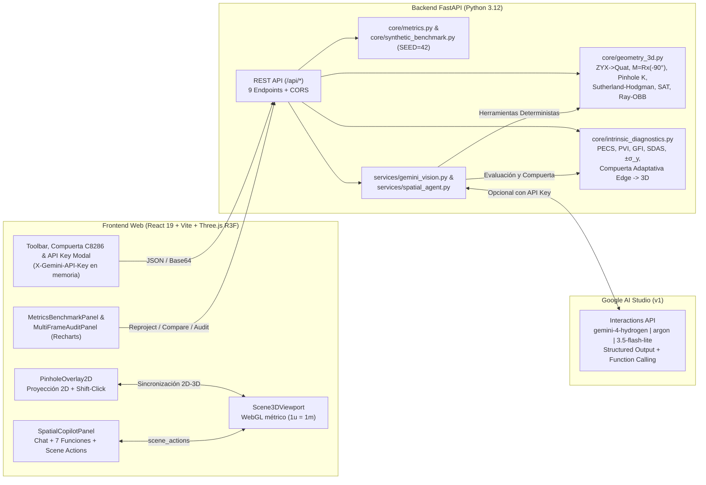

# MyLeenTo3 — Percepción Espacial 3D Monocular y Compuerta Adaptativa Edge → VLM

> **Workbench Interactivo de Visión Computacional 3D (9-DOF), Auditoría Física Sin Referencia y Escalamiento Costo–Precisión Sin Hardware LiDAR**
>
> **Repositorio:** [`github.com/dariohuerta84/MyLeenTo3`](https://github.com/dariohuerta84/MyLeenTo3) · **Evolución 3D de:** [`dariohuerta84/C8286-Proyecto1-Vision-Clasica-vs-CNN`](https://github.com/dariohuerta84/C8286-Proyecto1-Vision-Clasica-vs-CNN)

---

## 1. Propuesta de Valor y Motivación Técnica

Una fotografía RGB común carece de información métrica explícita: la cámara no indica a cuántos metros se encuentra cada objeto, cuál es su volumen físico, qué obstáculos bloquean a otros ni cuánto margen libre de paso existe entre pares. Por otro lado, depender de sensores LiDAR encarece el despliegue, mientras que enviar el 100% de las escenas a modelos multimodales pesados resulta costoso, lento y propenso a alucinaciones geométricas en escenas oscuras u ocluidas.

**MyLeenTo3** resuelve este problema integrando percepción 3D de **Google AI Studio** con un motor geométrico determinista en Python y una **Compuerta de Confiabilidad y Escalamiento Edge → VLM**:

1. **Compuerta Adaptativa Edge → 3D (`cascade_policy`):** clasifica cada escena dentro de regímenes visuales (`clean`, `occlusion_bg`, `illumination_noise`, `hybrid_stress`), aprueba modelos ligeros/rápidos en escenas despejadas (`APROBADO`, reduciendo 45%–72% de latencia estimada), escala a razonamiento 3D profundo cuando hay oclusión severa o rotaciones extremas (`ESCALAR_MODELO`) y rechaza capturas físicamente incoherentes (`RECHAZADO_FISICA`).
2. **Cero Alucinaciones Numéricas (7 Herramientas Python):** el Copiloto 3D nunca calcula distancias ni colisiones mentalmente; invoca funciones verificables en Python para hallar distancia centro-a-centro, holgura mínima superficie-a-superficie, colisiones SAT 15-ejes y bloqueo óptico por trazado de rayos.
3. **Auditoría Física Universal sin Ground Truth:** evalúa fotos de celular, renders artísticos o cuadros de videojuegos mediante coherencia de gradientes Sobel (`PECS`), interpenetración volumétrica (`PVI`), levitación sobre plano de soporte latente (`GFI`), acoplamiento escala–profundidad (`SDAS`) e incertidumbre cuadrática de rango ($\pm\sigma_y$).
4. **Calibración Pinhole Viva y Auditoría Multi-Frame:** recalcula proyección 2D↔3D al variar $\text{FOV}_h$ en $< 10\text{ ms}$ y audita deriva de escala y oscilación angular entre cuadros consecutivos frente a *World Models* implícitos (como *Google Genie* o *Veo*).

📄 **Informe reproducible del proyecto (3 págs. A4 PDF):** [`docs/MyLeenTo3_Informe_Proyecto.pdf`](docs/MyLeenTo3_Informe_Proyecto.pdf) (fuente reproducible: [`docs/informe_myleento3.md`](docs/informe_myleento3.md) y [`docs/build_report_pdf.py`](docs/build_report_pdf.py)).

---

## 2. Origen y Evolución desde `C8286-Proyecto1-Vision-Clasica-vs-CNN`

**MyLeenTo3** continúa directamente la línea experimental iniciada en el proyecto de Computación Paralela [`C8286-Proyecto1-Vision-Clasica-vs-CNN`](https://github.com/dariohuerta84/C8286-Proyecto1-Vision-Clasica-vs-CNN), resolviendo las limitaciones inherentes a la clasificación 2D:

| Eje de Comparación | Proyecto Anterior (`C8286` · Visión 2D Edge) | Evolución Actual (`MyLeenTo3` · Visión 3D) |
| :--- | :--- | :--- |
| **Predicción espacial** | Etiquetas de clase 2D sin profundidad ni volumen | Cajas orientadas 9-DOF en metros $[x,y,z,\Delta x,\Delta y,\Delta z,r,p,\psi]$ |
| **Desempeño vs. degradación** | Descriptores HSV/LBP/HOG colapsan bajo oclusión/iluminación (`F1 <= 0.104`); `MobileNetV2 INT8` alcanza `F1 = 0.715` en oclusión | Cuantifica oclusión por rayos Kay-Kajiya (hasta `89%`) y escala automáticamente a `gemini-4-hydrogen` (`69.9% mIoU_3D`, `4.6 cm ATE`) |
| **Velocidad y escalamiento adaptativo** | `POSIX SharedMemory` (`786.1 FPS`), `TinyCNN INT8` (`87.5 KB`, `2,527.1 FPS`), cascada `64→224` Edge↔GPU (`-97.5%` ancho de banda) | Compuerta determinista Edge → VLM: aprueba tiers ligeros en `clean` y bloquea alucinaciones físicas antes de decidir acciones |

---

## 3. Arquitectura del Sistema



---

## 4. Formulación Matemática y Diagnóstico Intrínseco

### 4.1 Representación 9-DOF y Cambio de Base Quiral (Gemini $\rightarrow$ Three.js)
Cada detección en el marco de cámara Gemini (**$X$ derecha, $Y$ profundidad hacia adelante, $Z$ arriba**) se parametriza como:

$$\mathbf{b} = [x, y, z, \Delta x, \Delta y, \Delta z, r, p, \psi] \in \mathbb{R}^9$$

con cuaternión intrínseco ZYX oficial de Gemini 3D y cambio de base ortogonal $M = R_x(-90^\circ) \in SO(3)$ ($\det(M) = +1$, sin espejado de ejes):

$$M = \begin{pmatrix} 1 & 0 & 0 \\ 0 & 0 & 1 \\ 0 & -1 & 0 \end{pmatrix}, \qquad \mathbf{p}_{\text{three}} = M\mathbf{p}_{\text{gem}} = \begin{pmatrix} x \\ z \\ -y \end{pmatrix}, \qquad R_{\text{three}} = M R_{\text{gem}} M^\top, \qquad \mathbf{s}_{\text{three}} = (\Delta x, \Delta z, \Delta y)$$

### 4.2 Proyección Pinhole, Oclusiones Kay-Kajiya y Compuerta Física
- **Proyección 2D *Pinhole*:** matriz intrínseca $K$ con distancia focal $f = W / (2\tan(\text{FOV}_h/2))$ y campo vertical exacto $\text{FOV}_v = 2\arctan(\tan(\text{FOV}_h/2)\cdot H/W)$.
- **Métricas Exactas:** $\text{IoU}_{\text{BEV}}$ por recorte **Sutherland-Hodgman**, $\text{IoU}_{\text{3D}}$ con filtro **SAT 15 ejes** + integración estratificada (`SEED=42`), emparejamiento Húngaro (`ATE`, `ASE`, `AOE`, `AP@0.25`, `AP@0.50`) e intervalos *Bootstrap* 95% ($N_{\text{boot}}=1000$).
- **Ray-Tracing de Oclusión:** intersección losa **Kay-Kajiya** desde $(0,0,0)$ hacia 9 objetivos por OBB trasera.
- **Compuerta Sin Referencia (`cascade_policy`):** combina coherencia fotométrica Sobel (`PECS`), colisiones volumétricas (`PVI`), anomalía de plano de piso (`GFI`), acoplamiento escala–profundidad (`SDAS`), truncamiento (`FBR`) e incertidumbre ($\pm\sigma_y$) para emitir el veredicto operativo `APROBADO`, `ESCALAR_MODELO` o `RECHAZADO_FISICA`.

---

## 5. Benchmarks Calibrados y Resultados (`SEED = 42`)

| Benchmark ID | Escenario | Objetos | Régimen C8286 | Veredicto Compuerta | Desafío Principal |
| :--- | :--- | :---: | :---: | :---: | :--- |
| `lab_desk_calibrated` | Mesa óptica de laboratorio | 5 | `clean` | **`APROBADO`** (`argon`, `-45%`) | Calibración métrica base (`1.6m – 3.4m`) |
| `occlusion_corridor` | Corredor con obstáculos | 6 | `occlusion_bg` | **`ESCALAR_MODELO`** (`hydrogen`) | Oclusiones severas (hasta `89%`, 6 pares) |
| `rotated_workshop` | Taller con rotaciones 3D | 5 | `clean` (`|yaw| >= 45°`) | **`ESCALAR_MODELO`** (`hydrogen`) | Rotaciones 9-DOF pronunciadas (`-65°..+70°`) |

### Desempeño Agregado Multi-Modelo (`960×640`, $\text{FOV}_h = 60^\circ$)

| Modelo | `thinking_level` | `mIoU_3D` | `mIoU_BEV` | `AP@0.25` | `ATE (m)` | `AOE (°)` | IC 95% `mIoU_3D` |
| :--- | :---: | :---: | :---: | :---: | :---: | :---: | :---: |
| `gemini-4-hydrogen` | `high` | **0.699** | **0.763** | **1.000** | **0.046** | **2.57°** | [0.618, 0.767] |
| `gemini-4-argon` | `medium` | 0.593 | 0.675 | 1.000 | 0.074 | 4.71° | [0.521, 0.659] |
| `gemini-3.5-flash-lite` | `low` | 0.367 | 0.475 | 0.582 | 0.166 | 9.94° | [0.224, 0.503] |

En secuencia multi-cuadro (`world_model_corridor_audit`, 4 cuadros), el auditor temporal reporta **`geometric_stability_score = 58.5 / 100`**, deriva media de volumen **`10.87%`** y *yaw jitter* medio **`5.78°`**.

---

## 6. Endpoints de la API REST (`/api/*`)

| Método | Ruta | Descripción |
| :--- | :--- | :--- |
| `GET` | `/api/health` | Estado del servicio, modelos soportados y versión de `google-genai`. |
| `GET` | `/api/benchmarks` | Catálogo de las 3 escenas calibradas con imágenes Base64 y *Ground Truth*. |
| `POST` | `/api/analyze` | Inferencia 3D (live o fallback adaptativo por saliencia), proyección 2D, oclusiones, diagnósticos y `cascade_policy`. |
| `POST` | `/api/reproject` | Recálculo instantáneo ($< 10\text{ ms}$) de proyección 2D, $\text{FOV}_v$, métricas y `cascade_policy` al ajustar $\text{FOV}_h$. |
| `POST` | `/api/measure` | Distancia centro-a-centro, holgura mínima de superficie, colisión SAT e IoU entre 2 objetos. |
| `POST` | `/api/compare-models` | Comparativa reproducible entre `gemini-4-hydrogen`, `gemini-4-argon` y `gemini-3.5-flash-lite` + barrido de $\text{FOV}_h$. |
| `GET` | `/api/multiframe-demo` | Secuencia demostrativa de 4 cuadros (*World-Model Audit*) y reporte de consistencia geométrica. |
| `POST` | `/api/multiframe-audit` | Auditoría temporal (deriva de escala y *yaw jitter*) sobre cuadros arbitrarios. |
| `POST` | `/api/copilot` | Copiloto espacial multi-turno con **7 herramientas deterministas** (`focus_object`, `measure_distance`, `set_camera_view`, `analyze_occlusions_and_collisions`, `filter_objects`, `run_fov_sensitivity_sweep`, `evaluate_escalation_policy`). |

---

## 7. Inicio Rápido (Quickstart)

### Opción A: Desarrollo Local (`start_dev.sh` o `uv` + `npm`)

```bash
git clone https://github.com/dariohuerta84/MyLeenTo3.git
cd MyLeenTo3
./start_dev.sh
```
Inicia automáticamente el backend FastAPI en `http://127.0.0.1:8085` y el frontend Vite en `http://127.0.0.1:5173` (con proxy `/api` automático hacia `:8085`).

#### Instalación manual paso a paso y suite de pruebas
```bash
# Backend (Python 3.12 + uv)
cd backend
uv venv .venv
source .venv/bin/activate
uv pip install -r requirements.txt
uvicorn app.main:app --reload --host 127.0.0.1 --port 8085

# Ejecutar las 38 pruebas deterministas
.venv/bin/pytest -v

# Frontend (en una segunda terminal)
cd ../frontend
npm install
npm run dev
```

### Opción B: Contenedores con Docker Compose
```bash
cp .env.example .env
docker compose up --build
```
- **Interfaz Web (Nginx + SPA):** `http://localhost:5173`
- **API FastAPI (Swagger/OpenAPI):** `http://localhost:8000/docs`

### Configuración de API Key
1. **Modal en la interfaz web:** la clave se conserva únicamente en memoria de sesión del navegador y se envía vía cabecera `X-Gemini-API-Key` (sin persistencia en disco ni `localStorage`).
2. **Variable `.env`:** define `GEMINI_API_KEY=...` en el backend. Sin clave API, toda la plataforma opera con escenas calibradas y extracción local adaptativa por saliencia.

---

## 8. Regeneración Reproducible del Informe (PDF)

El documento [`docs/MyLeenTo3_Informe_Proyecto.pdf`](docs/MyLeenTo3_Informe_Proyecto.pdf) se compila ejecutando directamente el motor Python para inyectar métricas y veredictos reales:

```bash
backend/.venv/bin/python docs/build_report_pdf.py
pdfinfo docs/MyLeenTo3_Informe_Proyecto.pdf
```
