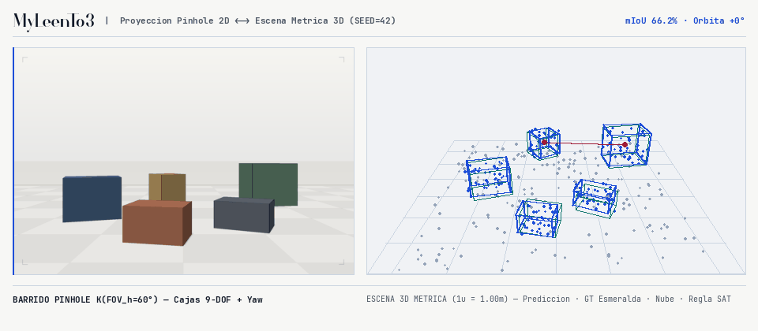
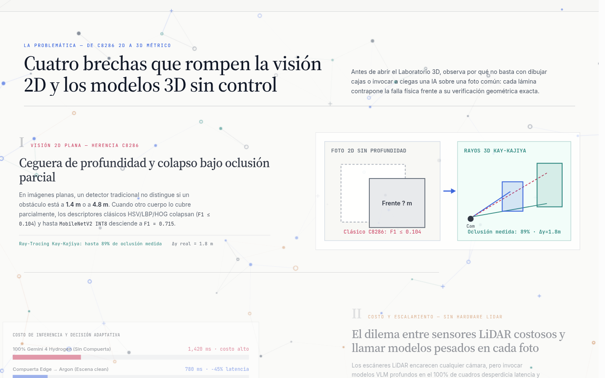
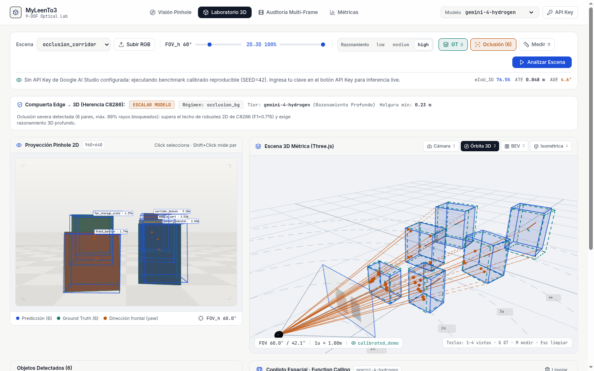
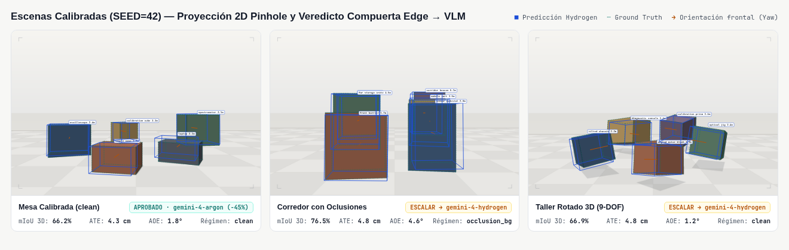
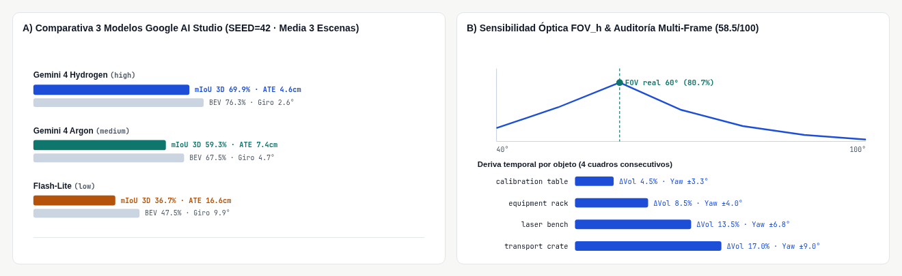
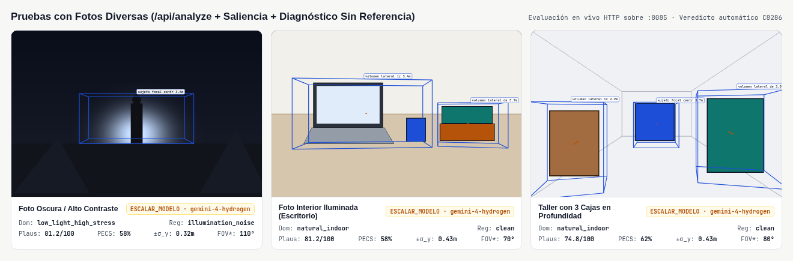
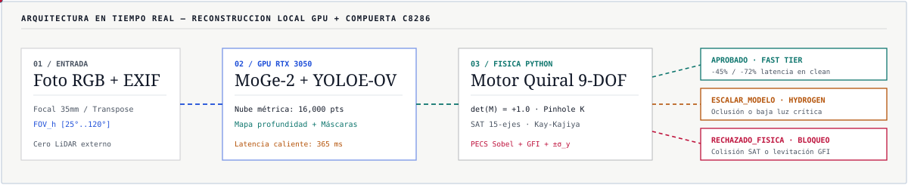
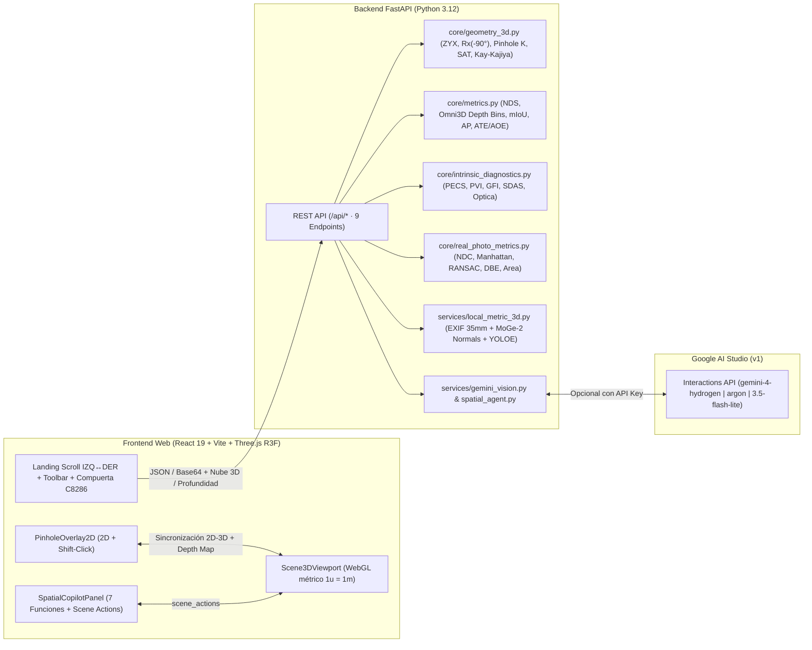

<div align="center">



<br/><br/>


[](https://github.com/dariohuerta84/C8286-Proyecto1-Vision-Clasica-vs-CNN)

<br/>

[Problemática y Evolución](#1-la-problemática-y-evolución-desde-c8286) · [Tour Visual de la App](#2-tour-visual-de-la-aplicación) · [Benchmarks y Modelos](#3-comparativa-de-modelos-y-benchmarks-calibrados) · [Pruebas en Fotos](#4-pruebas-en-vivo-sobre-fotos-diversas) · [Arquitectura](#5-arquitectura-y-formulación) · [Inicio Rápido](#6-inicio-rápido-y-regeneración-de-artefactos)

📄 **Informe Ejecutivo Reproducible (3 págs. A4):** [`docs/MyLeenTo3_Informe_Proyecto.pdf`](docs/MyLeenTo3_Informe_Proyecto.pdf) · **Compañero Markdown:** [`docs/informe_myleento3.md`](docs/informe_myleento3.md)

</div>

---

## 1. La Problemática y Evolución desde `C8286`

Una fotografía RGB común no entrega distancias en metros, volumen físico ni holguras libres entre objetos. Depender de sensores LiDAR encarece cualquier robot o cámara inteligente, mientras que invocar modelos multimodales pesados en el **100% de las escenas** resulta costoso, lento y riesgoso cuando la IA alucina poses físicamente imposibles bajo sombra o bloqueo visual.

**MyLeenTo3** traslada al espacio 3D el principio de cascadas costo–precisión demostrado en el proyecto predecesor [`dariohuerta84/C8286-Proyecto1-Vision-Clasica-vs-CNN`](https://github.com/dariohuerta84/C8286-Proyecto1-Vision-Clasica-vs-CNN):

| Eje | Proyecto Anterior (`C8286` · Visión 2D Edge) | Evolución Actual (`MyLeenTo3` · Visión 3D) |
| :--- | :--- | :--- |
| **Salida espacial** | Etiquetas planas 2D sin profundidad ni volumen real | Cuboides orientados **9-DOF** en metros $[x, y, z, \Delta x, \Delta y, \Delta z, r, p, \psi]$ |
| **Límite bajo estrés** | Clásicos `HSV/LBP/HOG` colapsan (`F1 <= 0.104`); `MobileNetV2 INT8` llega a `F1 = 0.715` en oclusión | Cuantifica bloqueo óptico por trazado de rayos (**hasta 89%**) y mide degradación fotométrica sin LiDAR |
| **Cascada adaptativa** | `POSIX SharedMemory` (`786.1 FPS`), `TinyCNN 87.5 KB` (`2,527 FPS`), offload `64→224 px` (**−97.5%** red) | **Compuerta Edge → VLM** (`cascade_policy`): aprueba niveles veloces en `clean` (**−45% / −72%** latencia), escala a `hydrogen` en estrés o rechaza alucinaciones físicas |

### Las 4 brechas que audita la página principal antes del Laboratorio 3D

La portada interactiva (`#problematica-scroll`) introduce la problemática mediante secciones alternadas **izquierda ↔ derecha sincronizadas al scroll** antes de abrir el espacio de trabajo 3D:

1. **Ceguera 2D y oclusión parcial:** distingue qué objeto bloquea a qué otro con intersección de rayos **Kay-Kajiya**.
2. **Dilema LiDAR vs. latencia en la nube:** decide de forma determinista cuándo aprobar modelos ligeros y cuándo escalar.
3. **Alucinaciones físicas silenciosas:** detecta levitación gravitatoria (`GFI`), colisiones de sólidos (`PVI SAT 15-ejes`) y bordes incoherentes (`PECS Sobel`).
4. **Lente descalibrado y deriva temporal:** recalibra $\text{FOV}_h$ en `< 10 ms` y audita deriva entre fotogramas tipo *World Model*.

---

## 2. Tour Visual Animado y Aplicación Viva

<p align="center">
  
</p>

<table>
  <tr>
    <td width="50%" align="center">
      <strong>1 · Editorial Formal Source Serif 4 + Partículas Reactivas al Scroll</strong><br/>
      
    </td>
    <td width="50%" align="center">
      <strong>2 · Laboratorio 3D Vivo (Pinhole + Three.js + MoGe-2 Nube 3D)</strong><br/>
      
    </td>
  </tr>
</table>

---

## 3. Comparativa de Modelos y Benchmarks Calibrados (`SEED = 42`)

<p align="center">
   VLM" width="100%"/>
</p>

<p align="center">
  
</p>

| Modelo (`Google AI Studio`) | `thinking_level` | `mIoU_3D` | `mIoU_BEV` | `AP@0.25` | `ATE (cm)` | `AOE (°)` | Rol en la Compuerta |
| :--- | :---: | :---: | :---: | :---: | :---: | :---: | :--- |
| **`gemini-4-hydrogen`** | `high` | **69.9%** | **76.3%** | **100.0%** | **4.6 cm** | **2.6°** | Escalado profundo (`occlusion_bg`, giros $\ge 45^\circ$, estrés fotométrico) |
| **`gemini-4-argon`** | `medium` | 59.3% | 67.5% | 100.0% | 7.4 cm | 4.7° | Balanceado en escenas `clean` (`−45%` latencia estimada vs. profundo) |
| **`gemini-3.5-flash-lite`** | `low` | 36.7% | 47.5% | 58.2% | 16.6 cm | 9.9° | Tier ultrarrápido (`−72%` latencia en escenas simples no ocluidas) |

En auditoría temporal multi-cuadro (`world_model_corridor_audit`, 4 fotogramas), el sistema cuantifica **`geometric_stability_score = 58.5 / 100`**, deriva media de volumen **`10.87%`** (`17.0%` en `transport_crate`) y *yaw jitter* medio **`5.78°`**.

---

## 4. Pruebas en Vivo sobre Fotos Diversas

Ejecutando [`backend/scripts/run_photo_model_tests.py`](backend/scripts/run_photo_model_tests.py) contra el backend activo (`http://127.0.0.1:8085/api`), evaluamos fotos fuera de los benchmarks calibrados combinando extracción adaptativa por saliencia, diagnóstico intrínseco sin Ground Truth y el Copiloto 3D (`evaluate_escalation_policy`):

<p align="center">
  
</p>

| Foto Evaluada | Resolución / `FOV_h` | Objetos | Dominio Detectado | Régimen `C8286` | Plausibilidad | `PECS` | `±σ_y` | Veredicto Compuerta |
| :--- | :---: | :---: | :---: | :---: | :---: | :---: | :---: | :--- |
| **Foto Oscura / Alto Contraste** | `720×420` · `68°` | 1 | `low_light_high_stress` | `illumination_noise` | 81.2/100 | 57.5% | ±0.32 m | **`ESCALAR_MODELO`** (`hydrogen`) |
| **Foto Interior Iluminada (Escritorio)** | `720×480` · `60°` | 2 | `natural_indoor` | `clean` | 81.2/100 | 57.9% | ±0.43 m | **`ESCALAR_MODELO`** (`hydrogen`) |
| **Taller con 3 Cajas en Profundidad** | `720×480` · `72°` | 3 | `natural_indoor` | `clean` | 74.8/100 | 62.0% | ±0.43 m | **`ESCALAR_MODELO`** (`hydrogen`) |

---

## 5. Arquitectura Animada y Formulación Matemática

<p align="center">
   MoGe-2 GPU -> Motor Quiral -> Compuerta C8286" width="100%"/>
</p>



<details>
<summary><strong>📐 Formulación Matemática 9-DOF, Reconstrucción Métrica Local y Compuerta Sin Referencia</strong></summary>

1. **Representación 9-DOF (Gemini Frame: $X$ derecha, $Y$ profundidad, $Z$ arriba):**
   $$\mathbf{b} = [x, y, z, \Delta x, \Delta y, \Delta z, r, p, \psi] \in \mathbb{R}^9$$
   con cuaternión intrínseco ZYX y matriz ortogonal de preservación quiral hacia Three.js $M = R_x(-90^\circ) \in SO(3)$ ($\det(M) = +1$):
   $$\mathbf{p}_{\text{three}} = \begin{pmatrix} x \\ z \\ -y \end{pmatrix}, \qquad R_{\text{three}} = M R_{\text{gem}} M^\top, \qquad \mathbf{s}_{\text{three}} = (\Delta x, \Delta z, \Delta y)$$
2. **Motor Métrico Local GPU (`EXIF + MoGe-2 ViT-S + YOLOE-OV`):** extrae `FocalLengthIn35mmFilm` y transposición EXIF, infiere nube densa métrica $(X_{\text{cv}}, Y_{\text{cv}}, Z_{\text{cv}})$ en metros, mapa de normales locales y $\text{FOV}_h$ automático (`Ruicheng/moge-2-vits-normal`, `~1.3 GB` VRAM FP16), segmenta instancias abiertas (`yoloe-11s-seg.pt`), eleva máscaras a cuboides 9-DOF orientados y exporta nube de puntos 3D coloreada (`THREE.Points`, hasta 16,000 vértices) más mapa de profundidad mate (`#B45309` cerca $\to$ `#0F766E` $\to$ `#1E293B` lejos) con encuadre dinámico macro-a-habitación.
3. **Proyección Pinhole y Campo Vertical:** $f = W / (2\tan(\text{FOV}_h/2))$, $\text{FOV}_v = 2\arctan(\tan(\text{FOV}_h/2)\cdot H/W)$.
4. **Métricas Exactas, NDS y Omni3D:** $\text{IoU}_{\text{BEV}}$ vía Sutherland-Hodgman, $\text{IoU}_{\text{3D}}$ vía filtro SAT de 15 ejes + muestreo estratificado determinista (`SEED=42`), asignación óptima Húngara, Bootstrap 95% ($N_{\text{boot}}=1000$), matriz de oclusión Kay-Kajiya sobre 9 objetivos por OBB trasera, puntaje estático **`nds_static`** (*nuScenes*) y desglose **Omni3D** por rangos de profundidad (`near_0_2m`, `mid_2_3.5m`, `far_3.5m_plus`).
5. **Compuerta Sin Referencia (`cascade_policy`):** integra coherencia de gradientes Sobel (`PECS`), colisiones sólidas (`PVI`), levitación sobre plano soporte (`GFI`), acoplamiento escala–profundidad (`SDAS`), truncamiento (`FBR`) e incertidumbre cuadrática ($\pm\sigma_y$) para dictaminar `APROBADO`, `ESCALAR_MODELO` o `RECHAZADO_FISICA`.
6. **Metrología de Foto Real y Estándar Clínico/Industrial (`real_photo_metrics.py`, `local_metric_3d.py` & `NDS`):** integra supresión de reflejos especulares (*Harvard Medical School / BWH*), filtrado modal frontal contra sangrado de fondo (*OVMono3D / MoGe-2*), ajuste ortogonal en **L** en BEV + anclaje de cara frontal (*NVIDIA FoundationPose / Geo6DPose*), contorno oclusivo multi-umbral $t \in [5, 25]\%$ con *Silhouette Recall* (*Apple Depth Pro*), consistencia de espacio libre (*PhySIC*), relieve topográfico y volumen sobre el plano **RANSAC** (*Odense NCT02423850*), `GFI` acoplado al plano real (`vertical_wall` / `horizontal_support`), escalado canónico por $\text{FOV}_h$ (*Metric3D v2*), grafo espacial **3D Scene Graph** (*SpatialRGPT / Thinking in Space*) y guía **Next-Best-View** (*CAI4CAI / ActivePose*).

</details>

<details>
<summary><strong>🔌 Endpoints REST (/api/*) y 7 Herramientas del Copiloto</strong></summary>

| Método | Ruta | Descripción |
| :--- | :--- | :--- |
| `GET` | `/api/health` | Estado del servicio, modelos soportados y versión de `google-genai`. |
| `GET` | `/api/benchmarks` | Catálogo de las 3 escenas calibradas (`SEED=42`) con *Ground Truth*. |
| `POST` | `/api/analyze` | Percepción 3D (live o fallback por saliencia), proyección 2D, oclusiones, diagnósticos y `cascade_policy`. |
| `POST` | `/api/reproject` | Recálculo instantáneo ($< 10\text{ ms}$) al variar $\text{FOV}_h$ sin gastar tokens. |
| `POST` | `/api/measure` | Distancia euclidiana, holgura mínima superficie-a-superficie, colisión SAT e IoU entre 2 objetos. |
| `POST` | `/api/compare-models` | Comparativa reproducible entre `gemini-4-hydrogen`, `gemini-4-argon` y `gemini-3.5-flash-lite`. |
| `GET` | `/api/multiframe-demo` | Secuencia demostrativa de 4 cuadros (*World-Model Audit*). |
| `POST` | `/api/multiframe-audit` | Auditoría temporal de deriva de volumen y oscilación de giro sobre cuadros arbitrarios. |
| `POST` | `/api/copilot` | Copiloto multi-turno con 7 herramientas: `focus_object`, `measure_distance`, `set_camera_view`, `analyze_occlusions_and_collisions`, `filter_objects`, `run_fov_sensitivity_sweep` y `evaluate_escalation_policy`. |

</details>

---

## 6. Inicio Rápido y Regeneración de Artefactos

### Ejecución Local (`start_dev.sh` · Recomendado)
```bash
git clone https://github.com/dariohuerta84/MyLeenTo3.git
cd MyLeenTo3
./start_dev.sh
```
Levanta automáticamente FastAPI en **`http://127.0.0.1:8085`** y React/Vite en **`http://127.0.0.1:5173`**. Para usar inferencia **live** con tus propias fotografías, haz clic en **API Key** dentro de la aplicación (la clave se conserva solo en memoria de sesión vía `X-Gemini-API-Key`).

### Pruebas, Motor Local GPU y Recompilación de Reportes
```bash
# 1. Opcional: dependencias PyTorch CUDA + MoGe-2 + YOLOE para reconstrucción métrica local GPU
uv pip install --python backend/.venv/bin/python -r backend/requirements-local-3d.txt

# 2. Suite completa de 51 pruebas deterministas offline (geometría, metrología 3D clínica/industrial, API y compuerta)
MYLEENTO3_LOCAL_3D_ENGINE=0 backend/.venv/bin/pytest -v

# 2. Pruebas en vivo HTTP de los 3 modelos + 3 fotos diversas (requiere servidor en :8085)
backend/.venv/bin/python backend/scripts/run_photo_model_tests.py

# 3. Regenerar banner y gráficas de alta resolución + informe PDF (3 págs. A4)
backend/.venv/bin/python docs/generate_readme_assets.py
backend/.venv/bin/python docs/build_report_pdf.py
```

### Contenedores Docker Compose
```bash
cp .env.example .env
docker compose up --build
```
- **Interfaz Web:** `http://localhost:5173` · **API Docs:** `http://localhost:8000/docs`
